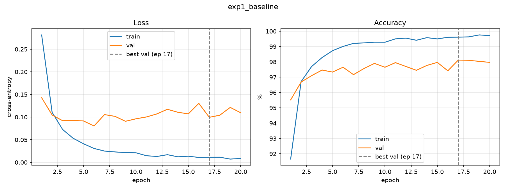
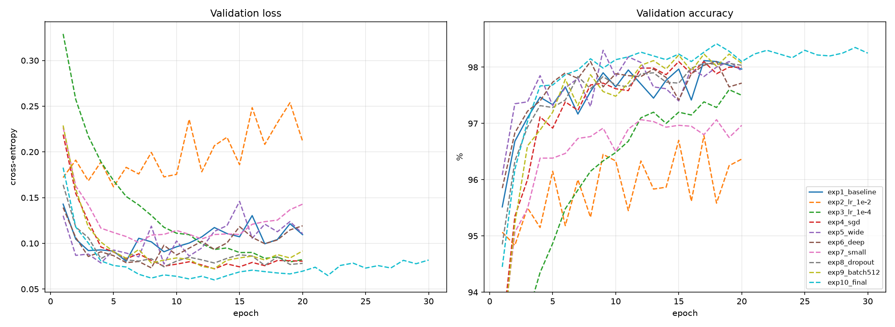
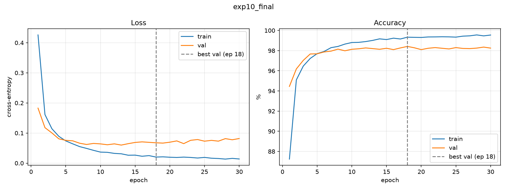
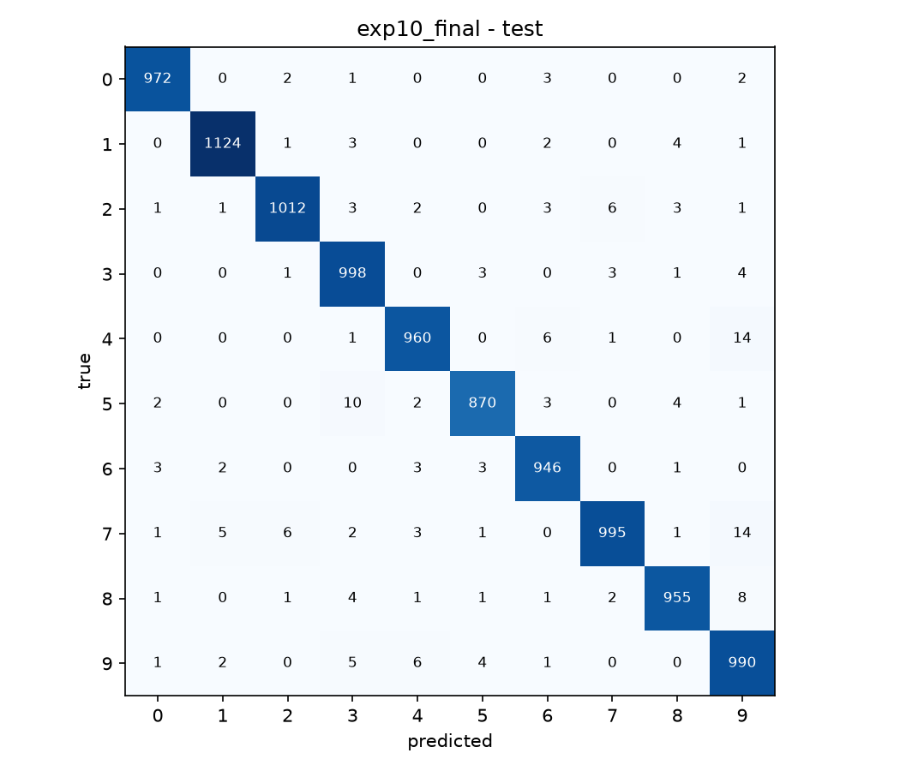
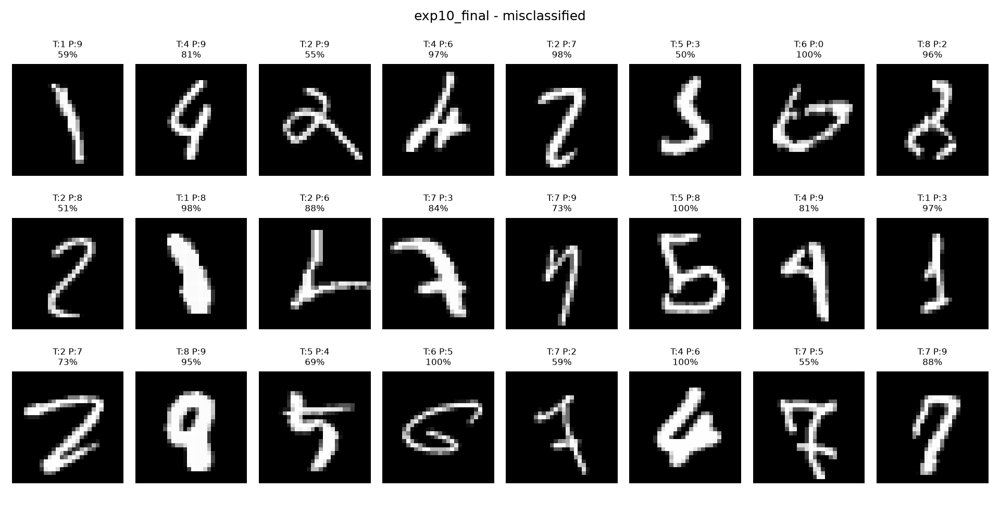
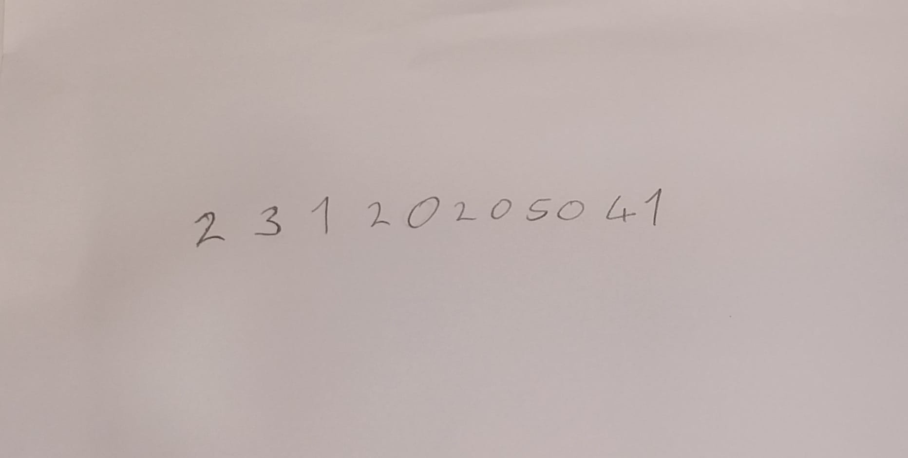
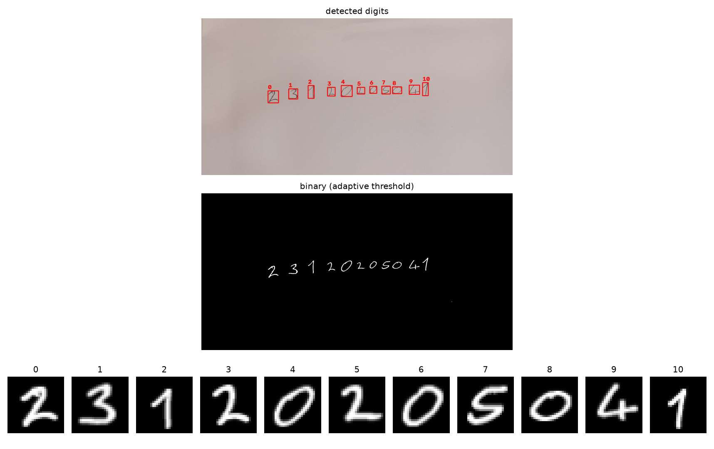
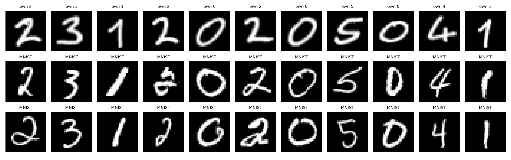
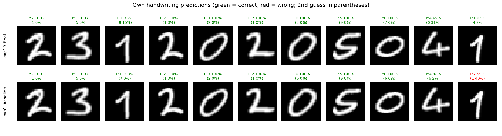

# MNIST ile MLP Tabanlı El Yazısı Rakam Tanıma

MNIST veri seti üzerinde sıfırdan eğitilen bir **Multi-Layer Perceptron (MLP)** ile el yazısı rakam tanıma. Proje temel bir MLP modeli (Deney 1), 8 hiperparametre deneyi, final model seçimi, test değerlendirmesi ve **kendi el yazımla yazdığım öğrenci numaramın** model tarafından tanınmasını içerir.

- **Framework:** PyTorch
- **Model:** Sadece MLP (CNN kullanılmamıştır), hazır eğitilmiş model kullanılmamıştır, tüm modeller sıfırdan eğitilmiştir.
- **Donanım:** NVIDIA RTX 3060 (6 GB), Python 3.12

---

## 1. Kurulum ve Çalıştırma

```bash
python -m venv .venv
# Windows: .venv\Scripts\Activate.ps1   |   Linux/macOS: source .venv/bin/activate

# PyTorch (CUDA). CPU için index-url kısmı kaldırılabilir.
pip install torch torchvision --index-url https://download.pytorch.org/whl/cu128
pip install -r requirements.txt
```

Tüm komutlar repo kök dizininden çalıştırılır:

```bash
python src/dataset.py                 # veri setini indir, train/val/test ayrımını kontrol et
python src/train.py --name exp1_baseline   # Deney 1
python src/run_experiments.py         # hiperparametre deneyleri (exp2-exp9)
python src/train.py --name exp10_final --hidden 512 256 --dropout 0.3 --batch-size 512 --epochs 30
python src/compare.py                 # tüm deneylerin karşılaştırma tablosu ve grafiği
python src/evaluate.py                # test seti değerlendirmesi (sadece exp1 ve exp10)
python src/preprocess_own.py --image my_digits/raw/handwriting.jpg   # el yazısını MNIST formatına çevir
python src/predict_own.py             # el yazısı üzerinde tahmin
```

Eğitilmiş ağırlıklar (`results/*/best_model.pt`) repoda bulunduğu için `evaluate.py` ve `predict_own.py` yeniden eğitim yapmadan çalıştırılabilir.

## 2. Proje Yapısı

```
mnist-mlp/
├── src/
│   ├── dataset.py          # MNIST yükleme, train/val/test ayrımı, normalizasyon
│   ├── model.py            # Parametrik MLP sınıfı
│   ├── train.py            # Eğitim döngüsü, metrik kaydı, grafikler, checkpoint
│   ├── run_experiments.py  # Hiperparametre deneylerini sırayla çalıştırır
│   ├── compare.py          # Deneylerin karşılaştırma tablosu ve grafiği
│   ├── evaluate.py         # Test accuracy, confusion matrix, hatalı örnekler
│   ├── preprocess_own.py   # Kendi el yazısı fotoğrafını 28x28 MNIST formatına çevirir
│   └── predict_own.py      # Kendi rakamlarım üzerinde tahmin ve analiz
├── results/
│   ├── norm_stats.json     # Train setinden hesaplanan mean/std
│   ├── comparison.md       # Tüm deneylerin tablosu
│   ├── comparison_curves.png
│   └── expN_*/             # Her deney: summary.json, curves.png, best_model.pt (+ test sonuçları)
├── my_digits/
│   ├── raw/handwriting.jpg # Öğrenci numaramın fotoğrafı
│   ├── processed/          # 28x28 hazırlanmış rakamlar
│   ├── preprocess_debug.png
│   ├── predictions.png
│   └── own_vs_mnist.png
└── requirements.txt
```

## 3. Veri Seti ve Train / Validation / Test Ayrımı

| Küme | Kaynak | Örnek sayısı | Kullanım amacı |
|---|---|---|---|
| Train | MNIST train | 54.000 | Ağırlıkların öğrenilmesi |
| Validation | MNIST train (rastgele ayrılmış) | 6.000 | Epoch / model / hiperparametre seçimi |
| Test | MNIST test (resmi) | 10.000 | **Sadece en sonda, bir kez**, nihai ölçüm |

- Ayrım sabit bir seed (`42`) ile yapılmıştır, tekrarlanabilir.
- **Normalizasyon:** Piksel değerleri `[0,1]` aralığına çekilip `(x - mean) / std` uygulanmıştır. `mean` ve `std` **yalnızca train kümesinden** hesaplanmıştır (yaklaşık 0.131 / 0.308, `results/norm_stats.json`). Böylece validation/test bilgisi eğitime sızmaz.
- Test verisi eğitim, model seçimi ve hiperparametre ayarı sırasında **hiç kullanılmamıştır**. Tüm karşılaştırmalar validation sonuçlarıyla yapılmış, test sadece seçilen iki modelde (exp1_baseline ve exp10_final) bir kez çalıştırılmıştır.

## 4. Deney 1 – Temel MLP Modeli

### Mimari ve hiperparametreler

| Parametre | Değer |
|---|---|
| Mimari | 784 → 256 → 128 → 10 |
| Hidden layer sayısı | 2 |
| Aktivasyon | ReLU (çıkış katmanında yok, ham logit) |
| Loss | CrossEntropyLoss (softmax içinde uygulanır) |
| Optimizer | Adam, lr = 0.001 |
| Batch size | 128 |
| Epoch | 20 |
| Dropout | Yok |
| Parametre sayısı | 235.146 |
| Model seçimi | En yüksek validation accuracy'ye sahip epoch'un ağırlıkları |

### Sonuçlar

| Metrik | Seçilen epoch (17) | Son epoch (20) |
|---|---|---|
| Training loss | 0.0114 | 0.0087 |
| Validation loss | 0.0995 | 0.1095 |
| Training accuracy | 99.61% | 99.71% |
| Validation accuracy | **98.12%** | 97.97% |
| **Test accuracy** | **98.09%** (test loss 0.0959) | – |
| **Eğitim süresi** | **178.8 sn** (20 epoch, ~9 sn/epoch, RTX 3060) | |



### Yorum

- **Overfitting:** Validation loss en düşük değerine 6. epoch'ta ulaşıyor (0.0804). Sonrasında training loss 0.03'ten 0.009'a düşmeye devam ederken validation loss 0.10–0.13 bandına yükseliyor. Train ve validation accuracy arasındaki fark yaklaşık 1.7 puan. Model train setini ezberlemeye başlamış.
- **Val loss artıyor ama val accuracy düşmüyor:** Model doğru tahminlerini koruyor, ancak yanlış tahminlerinde giderek daha emin hâle geliyor. Cross-entropy emin yanlışları ağır cezalandırdığı için loss artıyor.
- **1. epoch'ta val accuracy > train accuracy:** Train accuracy epoch boyunca, ağırlıklar hâlâ değişirken ölçülüyor. Validation ise epoch sonunda, eğitilmiş modelle ölçülüyor.
- **Val ve test tutarlı:** Validation accuracy 98.12%, test accuracy 98.09%. Validation kümesi gerçek performansın iyi bir tahmincisi olmuş.
- **Süre:** Model GPU için çok hafif. Epoch süresinin büyük kısmı CPU'daki veri yüklemesine gidiyor.

## 5. Hiperparametre Deneyleri

Her deneyde Deney 1'e göre **yalnızca bir parametre** değiştirildi. Seed, veri ayrımı ve epoch sayısı sabit tutuldu. Karşılaştırma **validation** sonuçlarıyla yapıldı.

| Deney | Hidden | Opt | LR | Batch | Dropout | Params | Best ep | Best val acc | Final train acc | Final val acc | Min val loss | Final val loss | Süre (sn) |
|---|---|---|---|---|---|---|---|---|---|---|---|---|---|
| exp1_baseline | 256-128 | adam | 0.001 | 128 | 0.0 | 235,146 | 17 | 98.12% | 99.71% | 97.97% | 0.0804 | 0.1095 | 178.8 |
| exp2_lr_1e-2 | 256-128 | adam | 0.01 | 128 | 0.0 | 235,146 | 17 | 96.78% | 98.29% | 96.37% | 0.1618 | 0.2117 | 181.8 |
| exp3_lr_1e-4 | 256-128 | adam | 0.0001 | 128 | 0.0 | 235,146 | 19 | 97.60% | 99.15% | 97.50% | 0.0797 | 0.0823 | 188.7 |
| exp4_sgd | 256-128 | sgd (m=0.9) | 0.01 | 128 | 0.0 | 235,146 | 15 | 98.10% | 99.99% | 98.00% | 0.0721 | 0.0805 | 189.6 |
| exp5_wide | 512-256 | adam | 0.001 | 128 | 0.0 | 535,818 | 9 | 98.30% | 99.65% | 97.93% | 0.0774 | 0.1105 | 208.4 |
| exp6_deep | 512-256-128 | adam | 0.001 | 128 | 0.0 | 567,434 | 8 | 98.10% | 99.76% | 97.72% | 0.0731 | 0.1192 | 206.0 |
| exp7_small | 64-32 | adam | 0.001 | 128 | 0.0 | 52,650 | 12 | 97.07% | 99.40% | 96.97% | 0.1009 | 0.1429 | 177.2 |
| exp8_dropout | 256-128 | adam | 0.001 | 128 | 0.3 | 235,146 | 17 | 98.07% | 98.73% | 98.03% | 0.0743 | 0.0781 | 181.7 |
| exp9_batch512 | 256-128 | adam | 0.001 | 512 | 0.0 | 235,146 | 17 | 98.23% | 99.96% | 98.07% | 0.0724 | 0.0916 | 166.5 |
| **exp10_final** | **512-256** | **adam** | **0.001** | **512** | **0.3** | **535,818** | **18** | **98.42%** | **99.55%** | **98.25%** | **0.0600** | **0.0817** | **255.0** (30 epoch) |



### Analiz

**Learning rate**
- **lr = 0.01:** En kötü sonuç (96.78%). Validation eğrisi sürekli salınıyor, loss yükseliyor. Adımlar çok büyük olduğu için optimizer minimuma oturamıyor.
- **lr = 0.0001:** Öğrenme çok yavaş, 20 epoch sonunda hâlâ yükseliyor (underfitting). Buna karşılık en az overfitting yapan deney.
- **Sonuç:** 0.001 bu problem için uygun değer.

**Optimizer:** SGD + momentum, Adam ile aynı accuracy'ye ulaştı (98.10%). Validation loss'u daha düşük ve daha kararlı. Adam başlangıçta daha hızlı ilerliyor, SGD daha yavaş ama daha düzgün yakınsıyor.

**Kapasite (genişlik / derinlik)**
- Daha geniş (512-256) ve daha derin (512-256-128) modeller, 2.3–2.4 kat parametreyle accuracy'yi sadece çok az artırdı. En iyi sonuçlarına erken epoch'larda (8–9) ulaşıp daha hızlı overfit ettiler: final val loss 0.11–0.12.
- Küçük model (64-32) belirgin şekilde daha düşük bir tavana sahip (97.07%).
- **Sonuç:** Kapasiteyi artırmak getiriyi çok az artırıyor, azaltmak net şekilde zarar veriyor.

**Dropout (0.3):** Overfitting'i en net azaltan değişiklik. Train–val accuracy farkı 1.74 puandan 0.70 puana düştü. Validation loss artık yükselmiyor (0.0743'ten 0.0781'e). Accuracy aynı kaldı, yani model ezberlemek yerine genellemeyi öğrendi.

**Batch size (512):** Epoch başına güncelleme sayısı 422'den 106'ya indi. Eğitim daha düzgün ve daha hızlı (166.5 sn), sonuç biraz daha iyi (98.23%).

**Önemli not:** Validation kümesi 6.000 örnek olduğundan %0.1'lik fark yalnızca 6 görüntüye karşılık geliyor. exp1, exp4, exp5, exp6, exp8 ve exp9 arasındaki 0.1–0.3 puanlık farklar tek seed ile istatistiksel olarak anlamlı kabul edilmemelidir. Net sonuçlar şunlar: yüksek lr ve küçük model zarar veriyor, dropout overfitting'i azaltıyor.

### Final model seçimi (exp10_final)

Validation bulguları birleştirildi:
- **512-256:** En iyi validation accuracy bu genişlikten geldi.
- **Dropout 0.3:** Geniş modelin overfitting'ini engellemek için.
- **Batch 512:** Daha kararlı ve hızlı eğitim için.
- **30 epoch:** Dropout ve büyük batch öğrenmeyi yavaşlattığı için.

Sonuçta en yüksek validation accuracy (98.42%) ve belirgin farkla en düşük validation loss (0.0600, diğer iyi deneyler 0.072–0.080) elde edildi. Validation eğrisi de en kararlı eğri. Bu seçim tamamen validation sonuçlarına dayanarak yapılmıştır.



## 6. Test Sonuçları

| Model | Val acc | **Test acc** | Test loss | Hatalı örnek |
|---|---|---|---|---|
| exp1_baseline | 98.12% | **98.09%** | 0.0959 | 191 / 10.000 |
| exp10_final | 98.42% | **98.22%** | 0.0670 | 178 / 10.000 |

- exp10, accuracy'de baseline'dan az farkla, loss'ta ise belirgin şekilde (~%30) daha iyi. Yanlış tahminlerinde daha az emin, yani daha iyi kalibre.
- Validation ve test sonuçları birbirine çok yakın. Model seçimi validation kümesine aşırı uyum sağlamamış.
- **En çok karışan çiftler** (gerçek → tahmin): 4 → 9 (14), 7 → 9 (14), 5 → 3 (10), 8 → 9 (8). Bunlar görsel olarak birbirine benzeyen rakamlar.
- Hatalı örneklerin bir kısmı insan için de belirsiz. Bazı hatalar ise MLP'nin **çizgi kalınlığına ve konuma** duyarlılığından kaynaklanıyor. Örneğin çok kalın bir "1" yüksek güvenle "8" olarak tahmin edilmiş.




## 7. Kendi El Yazımla Test

### Görüntünün hazırlanması

Öğrenci numaram (**23120205041**) beyaz kâğıda tükenmez kalemle yazılıp telefonla fotoğraflandı.



`preprocess_own.py` ile fotoğraf MNIST'in hazırlanış biçimi taklit edilerek dönüştürüldü:

1. **Gri tonlamaya çevirme**
2. **Adaptive threshold + renk ters çevirme:** Fotoğrafta ışık eşit dağılmadığı için (gölge, pembe ton) sabit eşik yerine bölgesel eşik kullanıldı. Rakamlar beyaz, arka plan siyah yapıldı (MNIST formatı).
3. **Rakamları ayırma:** Connected components ile her rakam bulundu. Gürültü ve kâğıt kenarı filtrelendi, yatayda örtüşen parçalar birleştirildi, rakamlar soldan sağa sıralandı.
4. **Çizgi kalınlaştırma (dilation):** Kalem çizgisi, rakam boyuna oranla MNIST'teki çizgilerden çok daha ince. Küçültme sırasında kaybolmaması için kalınlaştırıldı.
5. **20×20 kutuya sığdırma:** En-boy oranı korunarak.
6. **28×28'e yerleştirme ve kütle merkezine göre ortalama:** MNIST ile aynı yöntem.
7. **Normalizasyon:** Tahmin sırasında, eğitimdekiyle birebir aynı dönüşüm uygulandı: `[0,1]` aralığı ve train `mean`/`std`.




### Tahmin sonuçları

| Model | MNIST test acc | Tahmin | Doğru |
|---|---|---|---|
| exp10_final | 98.22% | `23120205041` | **11 / 11 (100%)** |
| exp1_baseline | 98.09% | `2312020504`**`7`** | **10 / 11 (90.9%)** |



### Değerlendirme: Distribution Shift ve Genelleme

- **Baseline'ın hatası:** Son rakam olan "1", %59 güvenle "7" olarak tahmin edildi (ikinci tahmin %40 ile 1). Benim yazdığım 1'lerin üstünde kanca var (Avrupa tarzı). MNIST'teki 1'lerin çoğu ise düz bir çubuk. Kanca 7'nin yatay çizgisine benzediği için model kararsız kaldı. Bu, eğitim verisinde az temsil edilen bir yazım alışkanlığının yol açtığı **distribution shift**'in somut bir örneği.
- **Doğru bilinen rakamlarda düşük güven:** exp10 çoğu rakamda %100 güvenle tahmin yaparken, riskli rakamlarda güveni düştü. Kancalı 1'de %73 (ikinci tahmin %15 ile 9), üstü açık 4'te %69 (ikinci tahmin %31 ile 6). Model bu rakamları doğru bildi ama karar sınırına yakın. MNIST test setindeki tipik yüksek güvenle karşılaştırıldığında, gerçek dünya verisinin modelin "alışık olmadığı" bölgeye düştüğü görülüyor.
- **Modeller örnek bazında farklı davranıyor:** İlk "1"de baseline daha emin (%99.7), exp10 daha kararsız (%73). Son "1"de ise tersi oluyor. 11 rakamlık bir örnekte 1 rakamlık fark, "exp10 gerçek el yazısında genel olarak daha iyidir" demek için yeterli değil.
- **Preprocessing'in rolü:** Elde edilen yüksek başarının önemli bir kısmı preprocessing'e bağlı. Kalınlaştırma, 20×20'ye sığdırma ve kütle merkezine göre ortalama ile rakamlar bilinçli olarak MNIST'e benzetildi. Ortalama piksel yoğunluğu kendi rakamlarımda 0.147, MNIST'te 0.131. MLP, görüntüyü 784 bağımsız piksel olarak gördüğü ve uzamsal yapıyı bilmediği için rakamın konumuna, boyutuna ve çizgi kalınlığına çok duyarlıdır. Bu adımlar olmadan distribution shift çok daha büyük olurdu.
- **Sınırlılık:** 11 rakam, gerçek dünya başarısını ölçmek için çok küçük bir örnek. %100 sonucu modelin her el yazısında başarılı olacağı anlamına gelmez.

## 8. Genel Sonuç

- 2 hidden layer'lı basit bir MLP, MNIST test setinde **%98.09** accuracy'ye ulaştı. Hiperparametre deneyleriyle seçilen final model **%98.22** accuracy elde etti ve test loss'u ~%30 azalttı.
- En etkili hiperparametreler learning rate (yanlış seçim ciddi zarar veriyor) ve dropout (overfitting'i belirgin şekilde azaltıyor) oldu. Kapasiteyi artırmanın getirisi sınırlı kaldı.
- Train/validation/test ayrımı sayesinde model seçimi test verisine dokunmadan yapıldı. Validation ve test sonuçlarının çok yakın çıkması bu sürecin doğru işlediğini gösteriyor.
- Kendi el yazımda final model 11/11 doğru tahmin yaptı. Ancak güven skorlarındaki düşüş ve baseline'ın kancalı "1" hatası, MNIST ile gerçek el yazısı arasındaki dağılım farkını açıkça gösteriyor.
- MLP'nin uzamsal yapıyı kullanamaması, onu gerçek dünya verisinde preprocessing'e bağımlı kılıyor. Bu sınırlama, görüntü problemlerinde CNN gibi uzamsal yapıyı kullanan mimarilerin neden tercih edildiğini de açıklıyor.